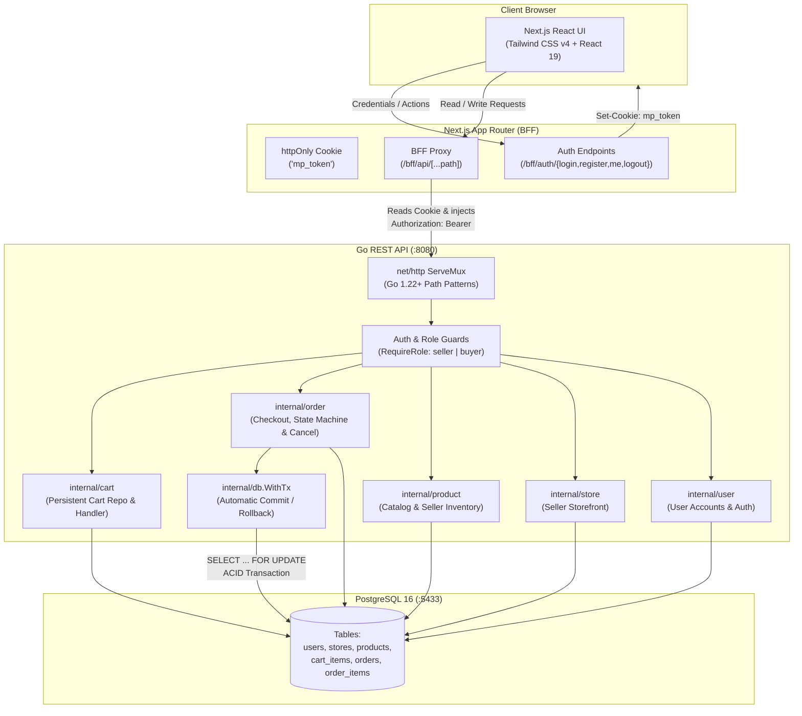

# Multi-Vendor E-Commerce Platform

A production-grade, multi-vendor e-commerce monorepo built with **Go** (clean architecture, zero heavy frameworks), **Next.js 16 App Router** (React 19, TypeScript), and **PostgreSQL 16**.

[](https://go.dev)
[](https://nextjs.org)
[](https://www.postgresql.org)
[](https://tailwindcss.com)

---

## Architecture Overview

The system uses a **BFF (Backend-For-Frontend)** architecture with secure cookie storage, decoupling public browser JavaScript from the backend API while protecting against Cross-Site Scripting (XSS) and token theft.



---

## Key Features

### 1. Multi-Vendor Separation & Per-Seller Order Split
- A buyer can add items from multiple distinct sellers into one persistent cart.
- At checkout, a single atomic transaction creates **one `orders` record per seller**, all linked together by a shared `checkout_id UUID`.
- Each seller only sees, fulfills, and updates their own orders.

### 2. ACID Concurrency & Deadlock Prevention
- **Pessimistic Locking:** `SELECT ... FOR UPDATE OF p ORDER BY p.id` locks all affected product rows before inspecting stock.
- **Consistent Lock Ordering:** Sorting by `p.id` guarantees that concurrent transactions locking the same items never deadlock (`A -> B` vs `B -> A`).
- **All-or-Nothing Rollback:** If any item has insufficient stock, the entire transaction aborts—no partial orders or uncollected payments.
- **Stock Restoration on Cancel:** Buyers can cancel `Pending` orders before shipment. The cancellation executes inside a database transaction, restoring stock atomically via `UPDATE products ... FROM order_items`.

### 3. Financial Snapshot Integrity
- Every currency value is stored and calculated in **integer cents (`BIGINT` / `int64`)**—never floating-point numbers.
- `order_items` stores historical snapshot columns:
  - `product_name VARCHAR(255)`
  - `unit_price_cents BIGINT`
- If a seller later edits the product price or deletes the product entirely, historical orders and invoices remain 100% accurate. `order_items.product_id` uses `ON DELETE SET NULL`.

### 4. Finite State Machine for Orders
- Pure Go transition functions govern the lifecycle of an order:
  - **Seller Actions:** `Pending` &rarr; `Shipped` &rarr; `Delivered` (forward-only, no skipping).
  - **Buyer Action:** `Pending` &rarr; `Cancelled`.
- **Compare-and-Swap (CAS):** `UPDATE orders SET status = $3 WHERE id = $1 AND seller_id = $2 AND status = $4` ensures concurrent buyer cancellations and seller shipments are resolved without lost updates.

### 5. Security & BFF Pattern
- Passwords hashed using **bcrypt** (cost 10).
- Signed **JWTs (HMAC-SHA256)** with verified claims (`user_id`, `email`, `role`).
- Stored exclusively in an **`httpOnly`, `SameSite=Lax`, secure cookie** managed by the Next.js BFF layer. JavaScript in the browser has zero access to raw JWT credentials, mitigating XSS token harvesting.

---

## Monorepo Project Structure

```text
marketplace/
├── docker-compose.yml             # Postgres 16 container (mapped to host :5433)
├── README.md                      # Project documentation
│
├── backend/                       # Go REST API
│   ├── cmd/api/
│   │   ├── main.go                # Server entrypoint & graceful shutdown
│   │   └── routes.go              # Route registration & ServeMux wiring
│   ├── internal/
│   │   ├── auth/                  # Password hashing & JWT token management
│   │   ├── cart/                  # Cart repository & endpoints
│   │   ├── config/                # Environment variable loading
│   │   ├── db/                    # pgxpool setup & WithTx transaction runner
│   │   ├── httpx/                 # Uniform JSON responses, errors, & pagination
│   │   ├── middleware/            # JWT authentication & role-based route guards
│   │   ├── order/                 # Checkout service, status state machine & tests
│   │   ├── product/               # Product CRUD & public catalog search
│   │   ├── store/                 # Seller storefront management
│   │   └── user/                  # User accounts & roles (seller | buyer)
│   ├── migrations/                # Embedded SQL migrations (golang-migrate)
│   │   ├── 000001_create_users.up.sql
│   │   ├── 000002_create_stores_and_products.up.sql
│   │   ├── 000003_create_cart_items.up.sql
│   │   └── 000004_create_orders.up.sql
│   └── go.mod
│
└── frontend/                      # Next.js 16 App Router
    ├── app/
    │   ├── bff/                   # BFF API proxy & authentication route handlers
    │   ├── cart/                  # Buyer cart view & quantity updates
    │   ├── checkout/              # Checkout review grouped by seller
    │   ├── login/                 # Buyer & seller login
    │   ├── orders/                # Buyer order history & detail (/orders/[id])
    │   ├── products/[id]/         # Product detail & add-to-cart
    │   ├── register/              # Registration with role selection
    │   ├── seller/                # Seller portal (dashboard, store, products, orders)
    │   ├── sellers/[id]/          # Public seller storefront profile
    │   ├── layout.tsx             # Root layout with system font stack
    │   └── page.tsx               # Product catalog, search & pagination
    ├── components/                # Reusable UI (Navbar, ProductCard, StatusBadge, etc.)
    ├── lib/                       # API client, TypeScript interfaces, auth context, schemas
    └── package.json
```

---

## Getting Started

### Prerequisites
- **Go 1.22+** installed
- **Node.js 18+** & **npm** installed
- **Docker** and **Docker Compose** installed

### 1. Start the Database
The PostgreSQL database is configured on port `5433` (preventing conflicts with any native Postgres on default `5432`):

```bash
docker compose up -d
```

### 2. Configure & Run Backend
```bash
cd backend
cp .env.example .env

# Run database migrations and start server on :8080
go run ./cmd/api
```
The server will automatically apply embedded SQL migrations upon startup and begin listening on `http://localhost:8080`.

### 3. Configure & Run Frontend
In a separate terminal window:
```bash
cd frontend
cp .env.example .env.local

# Install dependencies and start Next.js dev server on :3000
npm install
npm run dev
```
Open **[http://localhost:3000](http://localhost:3000)** in your browser.

---

## Test Accounts & Seed Data

| Role | Email | Password | Details |
| :--- | :--- | :--- | :--- |
| **Seller 1** | `alice@shop.com` | `password123` | Store: *Alice Artisan Crafts* |
| **Seller 2** | `seller2@shop.com` | `password123` | Store: *Nordic Woodworks* |
| **Buyer 1** | `bob@buyer.com` | `password123` | Customer with sample order history |
| **Buyer 2** | `carol@buyer.com` | `password123` | Clean buyer account |

---

## Running Tests & Verification

### Backend Unit & Integration Tests
```bash
cd backend

# Run all unit tests (state machine, JWT, auth, middleware, HTTP helpers)
go test -v ./...

# Run static analysis
go vet ./...

# Compile production binary
go build -o bin/api ./cmd/api
```

### Frontend Typechecking, Linting & Build
```bash
cd frontend

# TypeScript strict typecheck
npx tsc --noEmit

# ESLint verification
npm run lint

# Next.js optimized production build
npm run build
```

---

## Design Decisions & Trade-Offs

| Decision | Chosen Solution | Rejected Alternative | Rationale |
| :--- | :--- | :--- | :--- |
| **Money Representation** | `int64` / `BIGINT` (cents) | `float64` / `NUMERIC` | Floating-point math introduces binary rounding errors (e.g., `0.1 + 0.2 = 0.30000000000000004`). Integer cents eliminate rounding errors entirely. |
| **Multi-Seller Checkout** | Grouped `orders` rows with `checkout_id UUID` | Parent order + Sub-orders tables | Avoids ambiguous state when Seller A ships while Seller B cancels. Each order has a single owner and clean lifecycle. |
| **Concurrency Control** | `SELECT ... FOR UPDATE` with `ORDER BY p.id` | Optimistic locking / retry loop | Under high contention (e.g. flash sales on the last item), optimistic retries cause CPU thrashing. Pessimistic row locking enforces strict queueing and eliminates deadlocks. |
| **Authentication Flow** | BFF with `httpOnly` cookie | Storing JWT in `localStorage` | Storing access tokens in `localStorage` exposes them to XSS attacks and third-party script scraping. `httpOnly` cookies cannot be accessed by browser JavaScript. |
| **Go Routing** | Standard library `net/http` (Go 1.22+) | Gin / Fiber / Echo | Standard library `ServeMux` now natively supports method matching (`GET /path`) and wildcards (`/products/{id}`). Eliminates external routing dependencies. |

---

## Future Enhancements (Production Roadmap)
- [ ] Integration with a real payment gateway (Stripe Connect custom accounts for seller payouts).
- [ ] Asynchronous event queue (RabbitMQ / NATS) for transactional notification emails and shipping webhooks.
- [ ] Full-text search engine (Typesense / Elasticsearch) for large-scale catalog fuzzy matching and facets.
- [ ] Automated shipping carrier tracking updates (EasyPost / ShipStation webhook ingestion).
